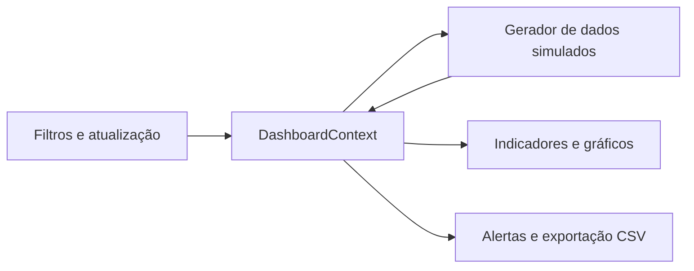

# Bovinus Intelligence

**Inteligência operacional para restaurantes por quilo**

Hackathon FMU TECH 2026.2 | Bovinu'S Grill & Beer — Augusta

[Vídeo demonstrativo com narração](https://youtu.be/2u7EFK9CPmA) · [Dashboard](https://id-preview--b333be96-c014-405d-9023-448cdab2b203.lovable.app) · [Documentação](docs/documentacao.md) · [Apresentação](docs/apresentacao.html)

> MVP interativo com dados integralmente simulados. Não representa medições reais do restaurante.

## Sumário

- [Desafio e objetivo](#desafio-e-objetivo)
- [Solução e funcionalidades](#solução-e-funcionalidades)
- [Demonstração](#demonstração)
- [Desenvolvimento e arquitetura](#desenvolvimento-e-arquitetura)
- [Tecnologias e estrutura](#tecnologias-e-estrutura)
- [Execução local](#execução-local)
- [Validação](#validação)
- [Impacto esperado e evolução](#impacto-esperado-e-evolução)
- [Materiais de entrega](#materiais-de-entrega)

## Desafio e objetivo

**Quais informações o cliente demonstra, mas não conta?**

O peso total do prato não revela sua composição. Filas, mesas aguardando limpeza e alimentos de baixa saída podem passar despercebidos quando a gestão depende de observação informal.

O objetivo é transformar sinais da jornada do cliente em indicadores que apoiem decisões sobre atendimento, produção, reposição e utilização das mesas.

## Solução e funcionalidades

O Bovinus Intelligence centraliza informações operacionais em cinco módulos:

| Módulo | Indicadores | Decisão apoiada |
| --- | --- | --- |
| Visão geral | Indicadores consolidados e alertas | Priorizar gargalos |
| Mix dos pratos | Composição estimada de carnes e acompanhamentos | Planejar reposição |
| Filas | Espera na entrada e churrasqueira | Redistribuir atendimento |
| Mesas | Ocupação, giro e limpeza | Priorizar liberação de mesas |
| Qualidade e sobras | Produção, saída e sobras estimadas | Ajustar produção |

Recursos adicionais: filtros por período e turno, atualização manual, simulação automática a cada 10 segundos, alertas e exportação CSV.

## Demonstração

[**Assistir ao vídeo demonstrativo com narração no YouTube**](https://youtu.be/2u7EFK9CPmA)

[Abrir dashboard interativo](https://id-preview--b333be96-c014-405d-9023-448cdab2b203.lovable.app) (acesso sujeito às permissões da plataforma).

### Capturas de tela


## Desenvolvimento e arquitetura

1. Mapeamento dos quatro desafios operacionais.
2. Definição dos indicadores e prototipação das interfaces.
3. Implementação das telas e do gerador de dados sintéticos com auxílio do Lovable.
4. Integração dos filtros, indicadores, alertas e exportação.
5. Validação técnica e preparação da demonstração.



O contexto central integra os módulos com o conjunto de dados simulado. Não existe back-end de negócio, integração com câmeras ou persistência em banco de dados nesta versão.

## Tecnologias e estrutura

| Tecnologia | Finalidade |
| --- | --- |
| React 19 e TypeScript | Interface e lógica |
| TanStack Start e Router | Estrutura e navegação |
| Vite | Desenvolvimento e compilação |
| Tailwind CSS | Estilização |
| Bun | Dependências e execução |
| Vitest | Testes automatizados |

```text
src/
  components/dashboard/  Componentes e contexto
  data/mock.ts           Dados sintéticos
  routes/                Telas e navegação
  lib/csv.ts             Exportação CSV
  test/                  Testes automatizados
docs/                    Documentação e apresentação
docs media/              Capturas e gravação original
```

## Execução local

Pré-requisitos: Git e [Bun](https://bun.sh/).

```bash
git clone https://github.com/Richardglima/Hackathon-bovinus.git
cd Hackathon-bovinus
bun install
bun run dev
```

Abra o endereço informado no terminal.

## Validação

```bash
bun run test
bun run build
```

Na validação local de 25/11/2026, os três testes automatizados (dois arquivos de teste) passaram e a compilação foi concluída com sucesso. Os testes abrangem navegação e exportação CSV. Isso não comprova precisão ou impacto em operação real.

## Impacto esperado e evolução

A proposta busca reduzir desperdícios, melhorar a disponibilidade de mesas e diminuir gargalos de atendimento. Esses benefícios são hipóteses, não ganhos já medidos.

Arquitetura futura proposta: câmeras autorizadas → visão computacional → API Spring Boot → banco SQL → dashboard.

Antes de implantação, validar precisão, custos, privacidade e LGPD, priorizando dados agregados sem reconhecimento facial. Separar sobras de buffet de restos de pratos e medir indicadores em um piloto real.

## Materiais de entrega

| Material | Acesso |
| --- | --- |
| Documentação e fluxograma | [Abrir](docs/documentacao.md) |
| Apresentação executiva (cinco slides HTML) | [Abrir](docs/apresentacao.html) |
| Vídeo com narração | [YouTube](https://youtu.be/2u7EFK9CPmA) |
| Roteiro | [Abrir](docs/roteiro-video.md) |
| Gravação original sem narração | [Backup](docs%20media/ChatGPT%202026-11-25%2016-44-15.mp4) |
| Cinco capturas | [Pasta de mídia](docs%20media/) |

---

Projeto acadêmico desenvolvido para o Hackathon FMU TECH 2026.2. Não representa um sistema oficial da Bovinu'S.
