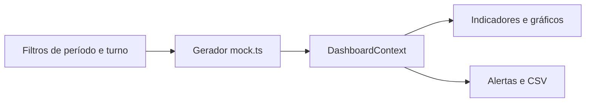

# Documentação técnica

O desafio é converter sinais visuais da jornada do cliente em métricas operacionais. O MVP utiliza dados sintéticos e não mede o restaurante real.

Evolução proposta: câmeras autorizadas → processamento visual → API Spring Boot → banco SQL → dashboard. Validar precisão, custos, privacidade e LGPD antes de operar. Sem reconhecimento facial.

Indicadores: composição estimada dos pratos, espera na entrada e churrasqueira, tempo de limpeza e giro, sobras sobre produção. Não confundir sobras de buffet com restos de pratos; a medição separada é futura.

Testes de navegação, filtros, estado vazio e CSV devem ser executados antes da entrega; resultados ainda não verificados.
